<p align="center">
  <a href="https://graphql-markdown.dev"></a>
</p>

<h1 align="center">API docs from your GraphQL schema, in the docs site you already use</h1>

<p align="center">
  GraphQL-Markdown generates <b>Markdown and MDX documentation</b> from <b>GraphQL schemas</b> for Docusaurus, Nuxt, Starlight, Fumadocs, Vocs, Hugo, MkDocs, mdBook, DocFX, Zola, Docsify and more.
</p>

<p align="center">
  <a href="https://www.npmjs.com/package/@graphql-markdown/core"></a>
  <a href="https://www.npmjs.com/package/@graphql-markdown/cli"></a>
  <a href="https://github.com/graphql-markdown/graphql-markdown/stargazers"></a>
  <a href="https://github.com/graphql-markdown/graphql-markdown/blob/main/LICENSE"></a>
</p>

<p align="center">
  <a href="https://graphql-markdown.dev/docs/get-started"><b>Documentation</b></a> ·
  <a href="#live-demos"><b>Live demos</b></a> ·
  <a href="https://graphql-markdown.dev/docs/try-it"><b>Try it</b></a> ·
  <a href="https://graphql-markdown.dev/showcase"><b>Showcase</b></a>
</p>

## Quick start

Run the scaffolder in an empty folder to create a new project, or inside an existing documentation site to add GraphQL-Markdown to it:

```shell
npm create graphql-markdown-docs@latest
```

New projects can be a Nuxt site (default), a Docusaurus site, or plain Markdown or MDX output with no site (`--framework markdown` or `--framework mdx`). In an existing site, the scaffolder detects the framework and writes a `.graphqlrc` and a `gqlmd` script. See the [Getting started guide](https://graphql-markdown.dev/docs/get-started) for options.

## Live demos

Same generator, your framework. Click any screenshot to explore the live site.

<table>
  <tr>
    <td align="center" width="33%">
      <a href="https://graphql-markdown.dev/demo-docusaurus/">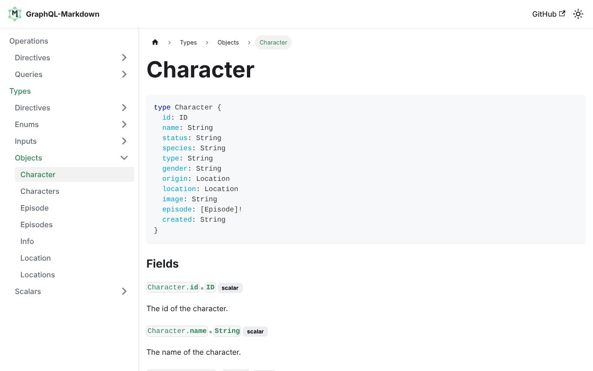</a>
      <br /><b>Docusaurus</b>
    </td>
    <td align="center" width="33%">
      <a href="https://graphql-markdown.dev/demo-nuxt/api-reference">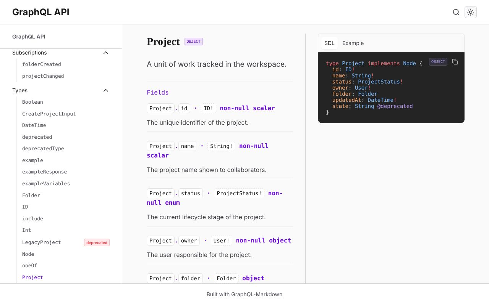</a>
      <br /><b>Nuxt</b>
    </td>
    <td align="center" width="33%">
      <a href="https://graphql-markdown.dev/demo-astro-starlight/">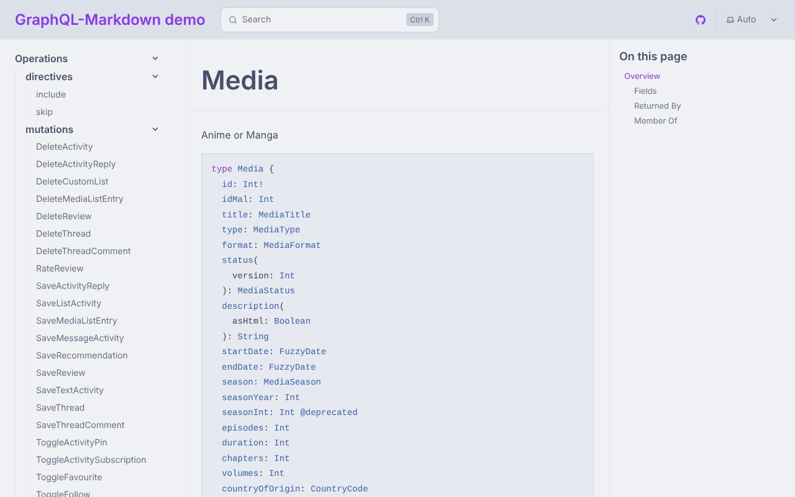</a>
      <br /><b>Astro / Starlight</b>
    </td>
  </tr>
  <tr>
    <td align="center" width="33%">
      <a href="https://graphql-markdown.dev/demo-nextjs-fumadocs/docs">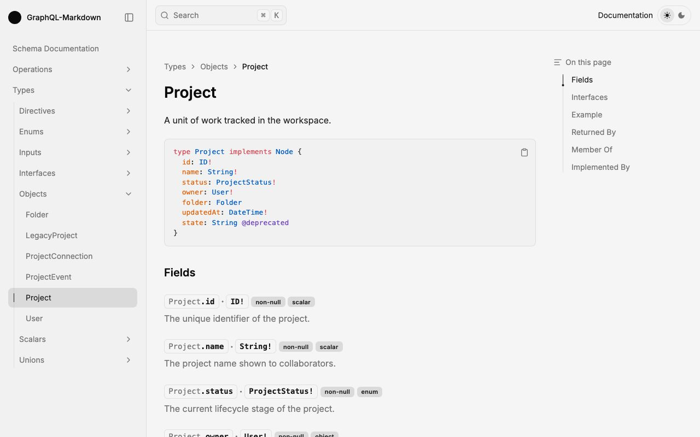</a>
      <br /><b>Next.js / Fumadocs</b>
    </td>
    <td align="center" width="33%">
      <a href="https://graphql-markdown.dev/demo-docus/docs">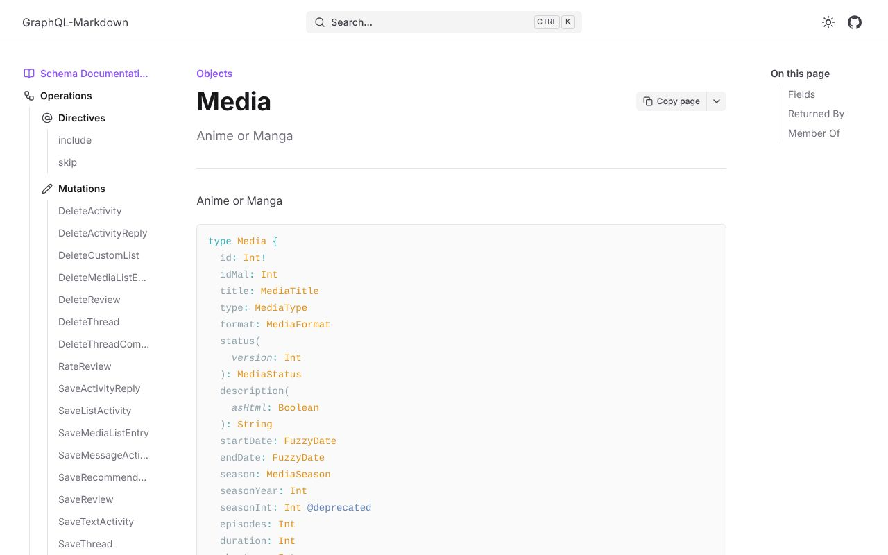</a>
      <br /><b>Nuxt / Docus</b>
    </td>
    <td align="center" width="33%">
      <a href="https://graphql-markdown.dev/demo-vite-vocs">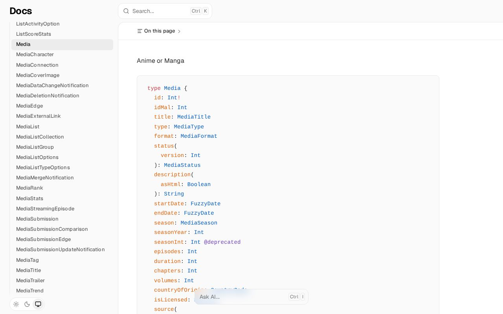</a>
      <br /><b>Vite / Vocs</b>
    </td>
  </tr>
  <tr>
    <td align="center" width="33%">
      <a href="https://graphql-markdown.dev/demo-hugo/">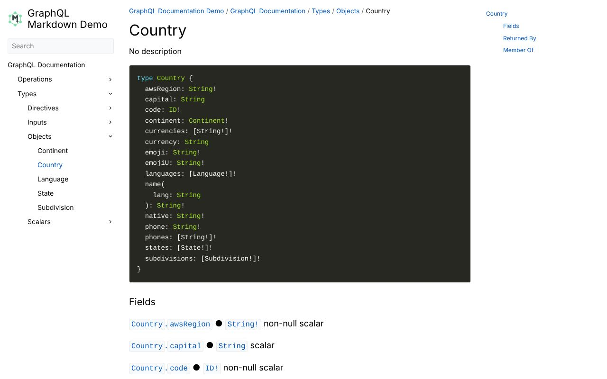</a>
      <br /><b>Hugo</b>
    </td>
    <td align="center" width="33%">
      <a href="https://graphql-markdown.dev/demo-mkdocs/">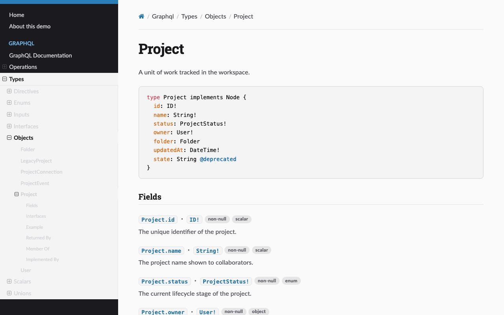</a>
      <br /><b>MkDocs</b>
    </td>
    <td align="center" width="33%">
      <a href="https://graphql-markdown.dev/demo-mdbook/graphql/index.html">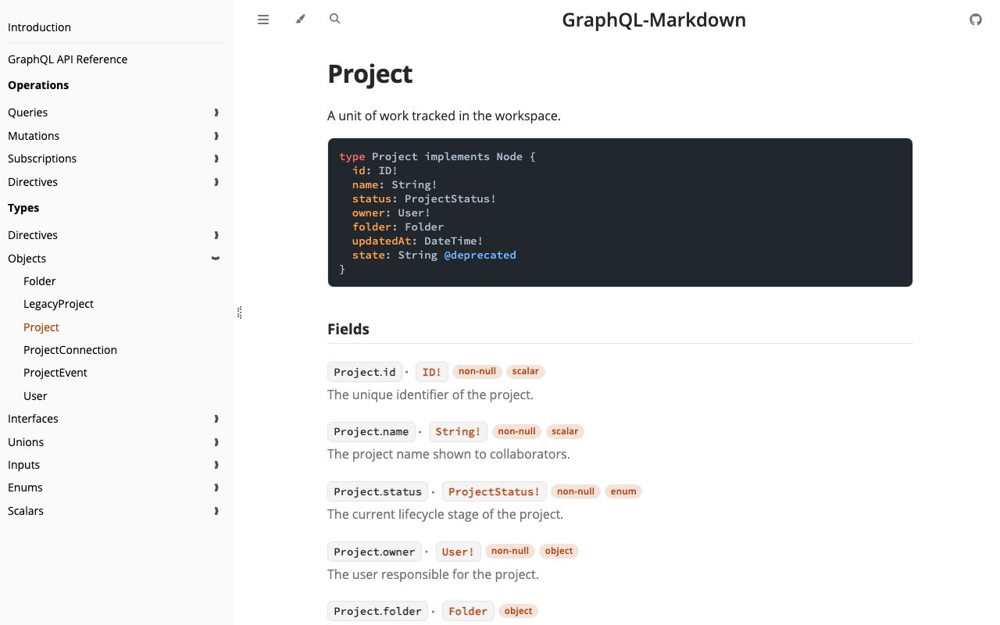</a>
      <br /><b>mdBook</b>
    </td>
  </tr>
  <tr>
    <td align="center" width="33%">
      <a href="https://graphql-markdown.dev/demo-docfx">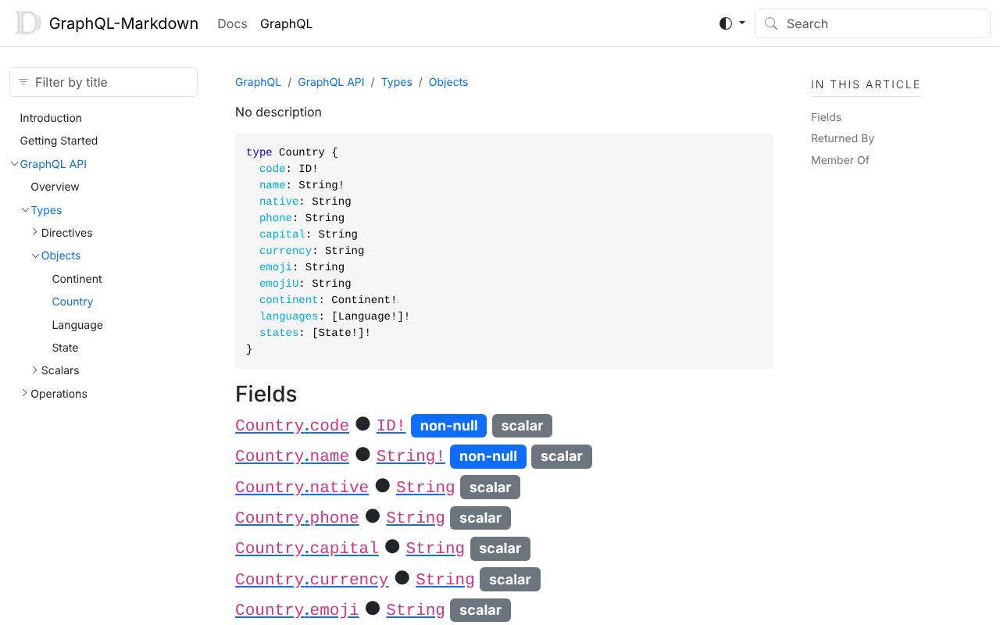</a>
      <br /><b>DocFX</b>
    </td>
    <td align="center" width="33%">
      <a href="https://graphql-markdown.dev/demo-honkit">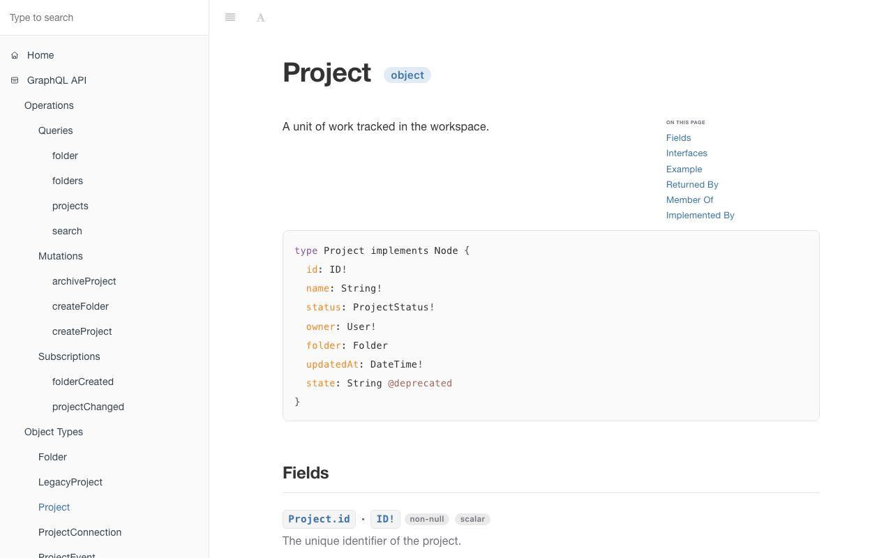</a>
      <br /><b>HonKit</b>
    </td>
    <td align="center" width="33%">
      <a href="https://graphql-markdown.dev/demo-zola/graphql/types/objects/project/">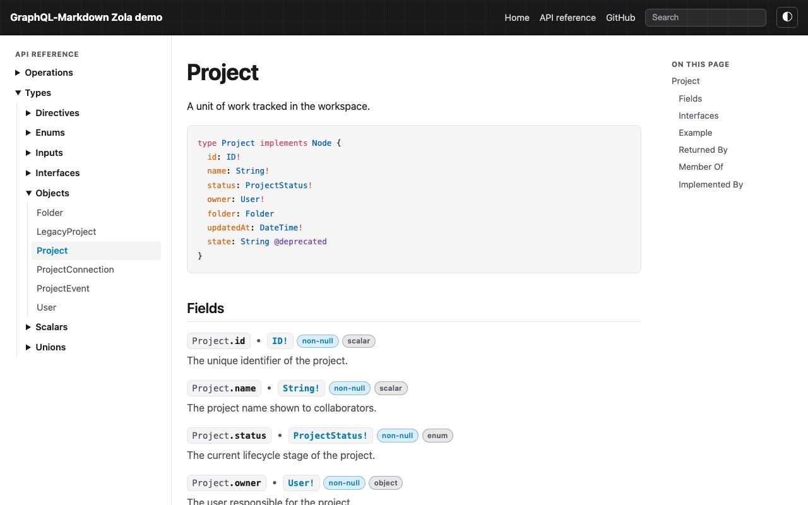</a>
      <br /><b>Zola</b>
    </td>
  </tr>
  <tr>
    <td align="center" width="33%">
      <a href="https://graphql-markdown.dev/demo-docsify/#/graphql/types/objects/project">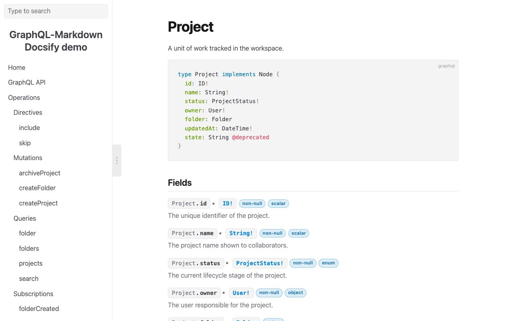</a>
      <br /><b>Docsify</b>
    </td>
    <td align="center" width="33%">
      <a href="https://graphql-markdown.dev/demo-pelican/graphql/types/objects/project/">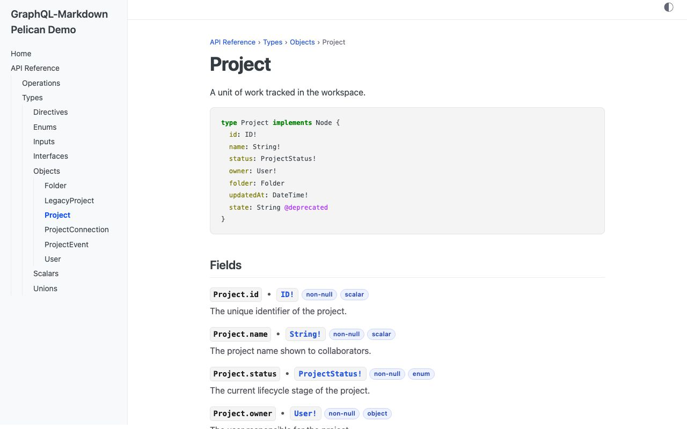</a>
      <br /><b>Pelican</b><br /><sub>custom formatter</sub>
    </td>
    <td align="center" width="33%">
      <b>Your stack?</b>
      <br />Use the generic <code>mdx</code> preset, or <a href="https://graphql-markdown.dev/docs/try-it">fork a demo</a> and try it with your own schema.
    </td>
  </tr>
</table>

Used in production by [30+ teams](https://graphql-markdown.dev/showcase) including Saleor, Sui, IOTA, Swan, Sablier, and Browserless. [Add your site](https://github.com/graphql-markdown/graphql-markdown/issues/1601).

## Manual installation

To set it up by hand instead of using the scaffolder, there are two main setup paths:

- use the official Docusaurus integration for Docusaurus sites
- use the CLI with formatter presets for other supported ecosystems such as Starlight, Fumadocs, Vocs, Hugo, MkDocs, DocFX, mdBook, HonKit, Zola and Docsify, or the generic `mdx` preset for any MDX-based site

Choose your preferred package based on your documentation stack:

```shell
# For Docusaurus sites
npm install @graphql-markdown/docusaurus graphql

# For formatter-based setups
npm install @graphql-markdown/cli @graphql-markdown/formatters graphql
```

## Usage

### Docusaurus Plugin

Add to your `docusaurus.config.js`:

```js
module.exports = {
  plugins: ["@graphql-markdown/docusaurus"],
};
```

Run the generation command:

```shell
npx docusaurus graphql-to-doc
```

### CLI Usage

Use the CLI directly for custom workflows, or pair it with `@graphql-markdown/formatters` to adapt the generated output for supported frameworks.

```shell
npx gqlmd graphql-to-doc --schema ./schema.graphql --root ./docs
```

For formatter-based setups:

```yaml
schema: ./schema.graphql
extensions:
  graphql-markdown:
    rootPath: ./docs
    baseURL: api
    formatter: "@graphql-markdown/formatters/hugo"
```

### API Usage

For programmatic usage, you can use the CLI package:

```typescript
import { runGraphQLMarkdown } from "@graphql-markdown/cli";

const config = {
  schema: "./schema.graphql",
  rootPath: "./docs",
};

await runGraphQLMarkdown(config);
```

See [API documentation](https://graphql-markdown.dev/api/) and our [Framework Integration page](https://graphql-markdown.dev/docs/guides/other-frameworks) for the full list of supported formatter presets.

## Configuration

See [documentation configuration](https://graphql-markdown.dev/docs/reference/configuration) page.

## Troubleshooting

See [documentation troubleshooting](https://graphql-markdown.dev/docs/troubleshooting) page.

## License

[](https://github.com/graphql-markdown/graphql-markdown/blob/main/LICENSE)
[](https://plant.treeware.earth/graphql-markdown/graphql-markdown)

GraphQL-Markdown packages are 100% free and open-source, under the [MIT license](https://github.com/graphql-markdown/graphql-markdown/blob/main/LICENSE).

This package is [Treeware](https://treeware.earth). If you use it in production, then we ask that you [**buy the world a tree**](https://plant.treeware.earth/graphql-markdown/graphql-markdown) to thank us for our work. By contributing to the Treeware forest you’ll be creating employment for local families and restoring wildlife habitats.

## Contributions

[](http://commitizen.github.io/cz-cli/)
[](https://app.codspeed.io/graphql-markdown/graphql-markdown?utm_source=badge)
[](https://www.npmjs.com/package/@graphql-markdown/cli)

[Contributions](https://github.com/graphql-markdown/graphql-markdown/blob/main/CONTRIBUTING.md), issues and feature requests are very welcome. If you are using this package and fixed a bug for yourself, please consider submitting a PR!

<p align="center">
  <a href="https://github.com/graphql-markdown/graphql-markdown/graphs/contributors">
    
  </a>
</p>

<p align="center">
  If GraphQL-Markdown saves you time, a <a href="https://github.com/graphql-markdown/graphql-markdown">⭐ on GitHub</a> helps other people find it.
</p>
